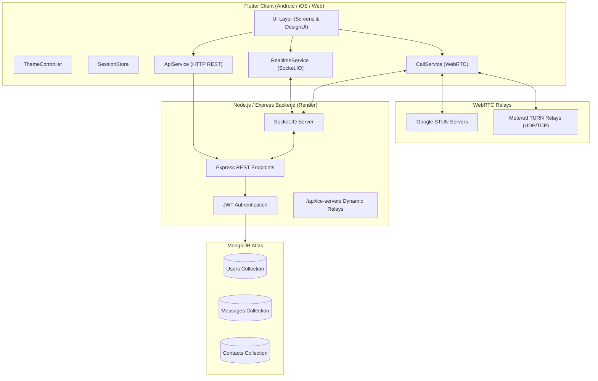

# AirMail - Complete Project Documentation & Technical Specification

Welcome to the comprehensive technical documentation for **AirMail**. This document details the product intentions, system architecture, page-by-page user interface breakdowns, design systems, services, data models, and backend implementations that power the application.

---

## Table of Contents
1. [Project Overview & Core Mission](#1-project-overview--core-mission)
2. [Tech Stack & Architecture](#2-tech-stack--architecture)
3. [Design System & Theming](#3-design-system--theming)
4. [Complete Page & UI Breakdown](#4-complete-page--ui-breakdown)
   - [4.1 Onboarding & Splash Screens](#41-onboarding--splash-screens)
   - [4.2 Authentication Screen](#42-authentication-screen)
   - [4.3 Main Application Shell (Home Screen)](#43-main-application-shell-home-screen)
   - [4.4 Navigation Drawer](#44-navigation-drawer)
   - [4.5 Inbox Page (Conversation List)](#45-inbox-page-conversation-list)
   - [4.6 Active Conversation Screen (Individual Page)](#46-active-conversation-screen-individual-page)
   - [4.7 Contact Management (Select & Add Contact)](#47-contact-management-select--add-contact)
   - [4.8 Audio Calling Screen](#48-audio-calling-screen)
   - [4.9 Mini-Games Hub & Games](#49-mini-games-hub--games)
   - [4.10 Camera & Media Capture](#410-camera--media-capture)
   - [4.11 Developer Profile Screen](#411-developer-profile-screen)
5. [Frontend Services & State Architecture](#5-frontend-services--state-architecture)
   - [5.1 Theme Controller](#51-theme-controller)
   - [5.2 Session Management](#52-session-management)
   - [5.3 REST API Service](#53-rest-api-service)
   - [5.4 Realtime Socket.IO Service](#54-realtime-socketio-service)
   - [5.5 WebRTC Calling Engine](#55-webrtc-calling-engine)
6. [Reusable UI Components (`lib/DesignUI/`)](#6-reusable-ui-components-libdesignui)
7. [Backend Architecture & Data Layer](#7-backend-architecture--data-layer)
   - [7.1 MongoDB Database Models](#71-mongodb-database-models)
   - [7.2 REST API Endpoints](#72-rest-api-endpoints)
   - [7.3 Socket.IO Events & Signaling Protocol](#73-socketio-events--signaling-protocol)
8. [Cross-Network Calling & WebRTC NAT Traversal](#8-cross-network-calling--webrtc-nat-traversal)
9. [Deployment & Configuration Guide](#9-deployment--configuration-guide)

---

## 1. Project Overview & Core Mission

**AirMail** is a real-time messaging, communication, and social utility application built for cross-platform modern mobile experiences.

### Core Intentions:
- **Zero-Friction Communication**: High-speed, responsive real-time messaging backed by persistent HTTP history and instantaneous WebSocket delivery.
- **Privacy & Presence**: Granular online/offline presence indicators, live typing detection, and unread badge synchronization without intrusive tracking.
- **Peer-to-Peer Audio Calls**: Crystal-clear 1:1 voice calling over WebRTC with automatic NAT traversal (STUN + TURN relays) that works seamlessly across different Wi-Fi and mobile networks.
- **Modern Material 3 Midnight Cyan Aesthetic**: Consistent visual identity balancing dark mode contrast with bright cyan highlights.
- **Offline & Offline Casual Utilities**: Integrated local offline mini-games (Tic-Tac-Toe, Rock Paper Scissors, Color Guess) ensuring engagement even when network conditions fluctuate.

---

## 2. Tech Stack & Architecture

### System Topology



### Stack Breakdown
- **Frontend**: Flutter 3.47.9 / Dart 3.13.7
  - `flutter_webrtc: ^1.6.3`: Audio media capture and peer-to-peer streaming.
  - `socket_io_client: ^2.0.0`: Real-time WebSocket connection.
  - `http: ^1.2.0`: REST communication.
  - `shared_preferences: ^2.2.2`: Encrypted local token, user profile, and theme persistence.
  - `image_picker: ^1.0.7`: Device camera and gallery capture.
- **Backend**: Node.js 18+, Express 4, Mongoose 7, Socket.IO 4
  - Password hashing with `bcryptjs`.
  - Stateless authentication with `jsonwebtoken` (JWT).
  - Rate limiting with `express-rate-limit`.
- **Infrastructure**:
  - Backend hosting on Render / Cloud VPS.
  - MongoDB Atlas Cloud Database.
  - Metered.ca TURN & Google STUN servers.

---

## 3. Design System & Theming

AirMail features the custom **Midnight Cyan** design palette with full support for Light Mode, Dark Mode, and Device System matching.

### Color Tokens (`lib/theme/app_colors.dart`)

| Token | Hex Value | Intended Usage |
|---|---|---|
| `primary` | `#00D4AA` | Brand primary color, active highlights, action buttons, active icons |
| `onPrimary` | `#08080C` | High contrast text/icons on primary surfaces |
| `primaryLightMode` | `#00A381` | High contrast primary adaptation for bright backgrounds |
| `darkBg` | `#08080C` | Deep black background for battery-efficient dark theme |
| `darkSurface` | `#101018` | AppBar, navigation bar, and card surfaces in dark theme |
| `darkRaised` | `#1A1A25` | Input fields, dialogs, elevated containers |
| `darkBorder` | `#232332` | Subtle separators, dividers, outline borders |
| `darkText` | `#F0F0F5` | Primary high-emphasis typography in dark theme |
| `darkMuted` | `#7E7E94` | Secondary text, timestamps, placeholder hints |
| `darkError` | `#FF5C6C` | Destructive actions, validation errors, call decline |
| `lightBg` | `#F6F7FA` | Clean light theme canvas |
| `lightSurface` | `#FFFFFF` | Cards and sheets in light theme |
| `lightRaised` | `#ECEEF3` | Form fields and elevated tiles in light theme |
| `lightBorder` | `#D8DCE5` | Borders and dividers in light mode |
| `lightText` | `#12131A` | High-contrast body and title typography in light mode |
| `lightMuted` | `#6A6D7C` | Subdued text in light mode |
| `online` | `#00E676` | Live presence indicator badge (emerald green) |

### Typography & Material 3
All typography leverages Google's **Lato** font family across regular (400), italic, and bold (700) weights, offering balanced legibility for messaging bubbles and headers.

---

## 4. Complete Page & UI Breakdown

### 4.1 Onboarding & Splash Screens
- **Files**:
  - `lib/Screens/Splash/splash_screen.dart`
  - `lib/Screens/Splash/components/introduction.dart`
  - `lib/Screens/Splash/components/body.dart`
  - `lib/Screens/Splash/components/splash_contents.dart`
- **Intention**:
  Welcomes first-time users, introduces the core value proposition of AirMail (instant chats, audio calls, privacy), and directs them smoothly to authentication.
- **UI & Interaction**:
  - Large centered branding icon (`Icons.message` in Midnight Cyan).
  - Clean two-tiered typography: bold title "AirMail - Modern Messaging" and an engaging subtitle.
  - "Get started" elevated pill button that routes to `LoginScreen` using `pushReplacement`.

---

### 4.2 Authentication Screen
- **File**: `lib/Screens/login_screen.dart`
- **Intention**:
  Single-entry authentication portal enabling both returning users to log in and new users to create accounts without leaving the screen.
- **UI & Layout**:
  - Top header with centered AirMail monogram/avatar, greeting title ("Welcome back" or "Create your account"), and explanatory subtitle.
  - Input form with styled Material 3 text fields:
    - **Full Name** (in registration mode): with `Icons.person_outline` prefix.
    - **Email Address**: lowercase normalization, validation with regex, `Icons.email_outlined` prefix.
    - **Password**: obscured text with visibility toggle eye icon (`Icons.visibility_outlined`).
  - Gradient / Solid Primary submission button with inline loading spinner when awaiting API response.
  - Mode switcher button ("Create a new account" / "Already have an account? Sign in") that smoothly animates the form between login and registration.
  - Error banner displays user-friendly server messages (e.g. "Account already exists", "Invalid credentials").

---

### 4.3 Main Application Shell (Home Screen)
- **File**: `lib/Screens/home_screen.dart`
- **Intention**:
  The central navigation hub providing instant tab switching, top-level actions, drawer access, and a background watcher for incoming WebRTC calls.
- **UI & Layout**:
  - **Top AppBar**:
    - Hamburger icon to slide open the Navigation Drawer.
    - Dynamic title matching the selected tab: "Inbox", "Contacts", "Calls", or "Games".
    - Overflow popup menu (`Icons.more_vert`) providing one-tap access to "New chat" (opens contact picker) and "Log out".
  - **Bottom NavigationBar**:
    - Material 3 navigation bar with active cyan pill indicators (`indicatorColor: primary.withValues(alpha: 0.2)`).
    - 4 destinations:
      1. `Inbox`: `Icons.chat_bubble_outline` / `Icons.chat_bubble`
      2. `Contacts`: `Icons.people_outline` / `Icons.people`
      3. `Calls`: `Icons.call_outlined` / `Icons.call`
      4. `Games`: `Icons.sports_esports_outlined` / `Icons.sports_esports`
  - **Floating Action Button**:
    - Present on the Inbox tab with edit icon (`Icons.edit_outlined`) to immediately open the contact picker for a new conversation.
  - **Global Call Listener**:
    - Attaches to `CallService.instance`. When an incoming or outgoing call event is detected, automatically pushes `CallPage` full-screen over whatever screen is currently open.

---

### 4.4 Navigation Drawer
- **File**: `lib/DesignUI/drawer_components.dart`
- **Intention**:
  Houses user identity, system actions, app settings, and the live instant theme toggle.
- **UI & Layout**:
  - **Drawer Header**:
    - Gradient banner containing the user's `AppAvatar` (56px).
    - User's display name and email address with automatic truncation.
    - **Theme Toggle Icon**: An interactive icon button located in the top-right of the header.
      - In Dark Mode: Displays a sun icon (`Icons.light_mode_outlined`) with tooltip *"Switch to light theme"*.
      - In Light Mode: Displays a moon icon (`Icons.dark_mode_outlined`) with tooltip *"Switch to dark theme"*.
      - Tapping immediately toggles between themes across the entire app with zero flicker, persisting the preference in local storage.
  - **Menu ListTiles**:
    - `Saved messages`: with bookmark icon (`Icons.bookmark_border_outlined`).
    - `Settings`: with gear icon (`Icons.settings_outlined`).
    - `Developer profile`: routes to `DeveloperScreen` with code icon (`Icons.code_outlined`).
    - `Log out`: highlighted tile with exit icon (`Icons.logout`) that clears token cache, disconnects sockets, and returns to `LoginScreen`.

---

### 4.5 Inbox Page (Conversation List)
- **File**: `lib/Page/chat_page.dart`
- **Intention**:
  Displays all active user conversations, tracks latest message previews, shows real-time unread badges, and updates dynamically upon incoming messages.
- **UI & Layout**:
  - **Empty State**: When no conversations exist, renders `EmptyState` with a chat bubble icon and a button to *"Start a chat"*.
  - **List of Conversations**:
    - Rendered via `CustomCard`.
    - Left side: Circular `AppAvatar` with dynamic green online dot if the contact is currently connected to Socket.IO.
    - Center: Contact name, latest message snippet (e.g. "Hey, are you free?"), and typing status if the contact is actively typing.
    - Right side: Relative timestamp ("Just now", "5m ago", "Yesterday") and an emerald cyan unread badge counter (`Container` with rounded pill and bold white count).
  - Pull-to-refresh (`RefreshIndicator`) to manually reload conversations from `GET /api/chats`.

---

### 4.6 Active Conversation Screen (Individual Page)
- **File**: `lib/Screens/indivisual_page.dart`
- **Intention**:
  The primary messaging interface for 1:1 communication, providing instant message dispatch, typing status exchange, message read receipts, and voice call launching.
- **UI & Layout**:
  - **Custom AppBar**:
    - Back button returning to Inbox.
    - Contact's initials avatar (`AppAvatar`, 40px).
    - Name and subtitle:
      - If user is typing: Green animated *"typing..."* text.
      - If user is online: *"Online"* with an emerald presence dot.
      - If offline: *"Offline"*.
    - Call action button (`Icons.call`): Instantly launches peer-to-peer audio call via `CallService`.
  - **Chat Message Feed**:
    - Scrollable `ListView` utilizing `MessageBubble`.
    - Outgoing messages align right with a primary cyan background tint (`AppColors.primary`).
    - Incoming messages align left with a raised neutral surface background.
    - Each bubble displays message text, timestamp, and read indicator icon (`Icons.done_all` for read, single check for sent).
  - **Bottom Message Input Bar**:
    - Rounded pill input field with hint "Type a message...".
    - Debounced typing indicator: Typing fires `RealtimeService.sendTyping(true)` and automatically stops after 2 seconds of inactivity.
    - Send button: Circular action button with paper airplane icon (`Icons.send`). Disabled when text is empty.
  - **Contact Auto-Addition**:
    - Sending a message automatically adds the recipient to the sender's contacts on the backend, ensuring two-way conversational continuity.

---

### 4.7 Contact Management (Select & Add Contact)
- **Files**:
  - `lib/Screens/select_contact_page.dart`
  - `lib/Screens/add_contact_page.dart`
- **Intention**:
  Manage the user's personal address book. Allows searching through contacts, starting conversations, and looking up new users by email.
- **UI & Layout**:
  - **Select Contact Page**:
    - Search bar at the top filtering contacts in real time.
    - Top action item: "New contact" tile with an add-user icon (`Icons.person_add_alt_1`) opening `AddContactPage`.
    - Contact list rendered via `ContactCard` displaying avatar, name, email, and live presence indicator.
    - Tapping any contact opens `IndivisualPage`.
  - **Add Contact Page**:
    - Input field for entering an email address with a clear button and search icon.
    - Search result card showing user avatar, name, and email:
      - If already a contact: Displays "Already in contacts" chip.
      - If new user: Displays a cyan "Add to contacts" button.
      - If not found: Clean error alert "No user found with that email".

---

### 4.8 Audio Calling Screen
- **Files**:
  - `lib/Screens/call_page.dart`
  - `lib/Screens/calls_screen.dart`
- **Intention**:
  Full-screen, distraction-free voice communication interface supporting incoming, outgoing, connecting, active, and ended call states.
- **UI & Layout**:
  - Background features a subtle radial/linear cyan gradient.
  - **Center Information**:
    - Large 124px avatar of the peer.
    - Large bold caller name and email address.
    - Dynamic status text:
      - *"Calling..."* (while outgoing call is ringing).
      - *"Incoming audio call"* (when receiving).
      - *"Connecting..."* (during WebRTC ICE & SDP negotiation).
      - Live elapsed call duration timer (e.g. `02:45`) once active.
      - *"Call ended"* / *"Call declined"* / *"Connection failed"* on disconnect.
  - **Incoming Call Controls**:
    - Red decline button with phone-off icon (`Icons.call_end`).
    - Green accept button with phone icon (`Icons.call`).
  - **Active Call Controls**:
    - Microphone mute toggle button (`Icons.mic` / `Icons.mic_off`).
    - Speakerphone toggle button (`Icons.volume_up` / `Icons.volume_down`).
    - Large red hangup button (`Icons.call_end`).
  - Auto-dismiss: Call screen automatically closes 1.2 seconds after a call finishes.

---

### 4.9 Mini-Games Hub & Games
- **Files**:
  - `lib/Screens/game_screen.dart`
  - `lib/Games/Tic_Tac_Toe/tic_tac_toe.dart`
  - `lib/Games/Rock_Paper_Scissor/rock_paper_scissor.dart`
  - `lib/Games/Color_Guess/guess_color.dart`
- **Intention**:
  Provides built-in, offline casual entertainment within the app.
- **UI & Gameplay**:
  - **Game Screen Hub**:
    - Responsive 2-column grid displaying game tiles with custom icons and titles.
  - **Tic-Tac-Toe**:
    - 3x3 grid board with animated taps.
    - Turn indicator (Player X vs Player O).
    - Automatic win-line calculation across 8 potential winning lines.
    - Score counter tracking X wins, O wins, and Draws.
  - **Rock Paper Scissors**:
    - Interactive player buttons (Rock, Paper, Scissors) with distinct iconography.
    - Computer opponent using randomized algorithmic selection.
    - Round outcome banner ("You win!", "Computer wins!", "It's a draw!").
    - Persistent player vs computer score board and "How to play" guide dialog.
  - **Color Guess**:
    - Swatch card displaying a target hex color.
    - Multiple choice color name buttons.
    - Score and attempts tracker encouraging color identification mastery.

---

### 4.10 Camera & Media Capture
- **Files**:
  - `lib/Screens/camera_screen.dart`
  - `lib/Page/camera_page.dart`
  - `lib/Screens/camera_page_indivisual.dart`
- **Intention**:
  Direct device camera access and preview interface for photo sharing.
- **UI & Layout**:
  - Full-width viewfinder container with rounded corners.
  - Floating action trigger that launches device camera via `ImagePicker`.
  - Live preview of the captured photo with retake options.

---

### 4.11 Developer Profile Screen
- **Files**:
  - `lib/Screens/developer_profile_screen.dart`
  - `lib/DesignUI/developer_screen_ui.dart`
- **Intention**:
  Provides developer attribution, technical information, and contact links.
- **UI & Layout**:
  - Centered circular profile picture.
  - Name ("Bijoy Biswas") and role badges.
  - Interactive contact tiles linking to Phone, Facebook, LinkedIn, Gmail, Telegram, Twitter/X, and GitHub.

---

## 5. Frontend Services & State Architecture

### 5.1 Theme Controller (`lib/theme/theme_controller.dart`)
- **Pattern**: Singleton `ChangeNotifier` listened to by `MaterialApp` using `ListenableBuilder`.
- **States**: `ThemeMode.system`, `ThemeMode.light`, `ThemeMode.dark`.
- **Persistence**: Key `app_theme_mode` in `SharedPreferences`.
- **Features**: `toggleTheme(context)` dynamically inspects current active brightness and flips to the opposite theme.

### 5.2 Session Management (`lib/services/session.dart`)
- **Model**: `Session` containing `token`, `userId`, `name`, and `email`.
- **Operations**:
  - `SessionStore.save(session)`: Writes auth data to `shared_preferences`.
  - `SessionStore.load()`: Restores session on app startup in `SessionGate`.
  - `SessionStore.clear()`: Destroys cached token on logout.

### 5.3 REST API Service (`lib/services/api_service.dart`)
- **Base URL**: Configurable via `--dart-define=AIRMAIL_API_URL` (defaults to deployed Render host).
- **Timeout**: 20 seconds with custom `ApiException` error parsing.
- **Endpoints Handled**:
  - `POST /api/auth/login`, `POST /api/auth/register`
  - `GET /api/contacts`, `GET /api/contacts/search`, `POST /api/contacts`, `DELETE /api/contacts/:id`
  - `GET /api/chats`, `GET /api/messages/:userId`, `POST /api/messages`
  - `POST /api/messages/read/:contactId`
  - `GET /api/ice-servers`: Fetches dynamic STUN and TURN configurations.

### 5.4 Realtime Socket.IO Service (`lib/services/realtime_service.dart`)
- **Connection**: Multiplexed WebSocket connection passing `auth: { token: session.token }`.
- **Streams**:
  - `messages`: Broadcasts incoming chat messages (`StreamController<MessageModel>`).
  - `callEvents`: Broadcasts call signaling events (`StreamController<CallEvent>`).
  - `presence`: Dispatches user online/offline status updates.
  - `typing`: Emits and listens for real-time typing indicators.

### 5.5 WebRTC Calling Engine (`lib/services/call_service.dart`)
- **Audio Capture**: 16kHz/48kHz audio streams with echo cancellation, noise suppression, and auto gain control (`getUserMedia`).
- **Peer Connection**: Unified-Plan WebRTC configuration with STUN and TURN relay fallback (`Metered.ca`).
- **Candidate Queue**: Buffers incoming ICE candidates until remote description is set (`_flushPendingCandidates`).
- **Audio Routing**: Native hardware switching between Earpiece and Speakerphone (`Helper.setSpeakerphoneOn`).

---

## 6. Reusable UI Components (`lib/DesignUI/`)

```
lib/DesignUI/
├── app_avatar.dart          # Initials avatar with hash-generated background colors and presence dot
├── message_bubble.dart      # Chat bubble with sender/receiver alignment, timestamp, and status checks
├── custom_card.dart         # Inbox conversation tile with unread badge counter and relative time
├── contact_card.dart        # Contact item tile with presence indicators
├── drawer_components.dart   # Navigation drawer with interactive theme toggle switch
├── empty_state.dart         # Graphic + text placeholder for empty tabs
├── button_card.dart         # Rounded icon action button
└── developer_screen_ui.dart # Contact badges for developer profile
```

---

## 7. Backend Architecture & Data Layer

The backend is built with Express 4, Socket.IO 4, and Mongoose 7 in `backend/server.js`.

### 7.1 MongoDB Database Models
1. **User Schema**:
   - `name`: String (1-80 chars)
   - `email`: String (unique, lowercase, indexed)
   - `password`: String (bcrypt hash)
   - `createdAt`: Date
2. **Message Schema**:
   - `sender`: ObjectId -> User
   - `receiver`: ObjectId -> User
   - `message`: String (1-5000 chars)
   - `createdAt`: Date (indexed)
   - `readAt`: Date (nullable)
3. **Contact Schema**:
   - `owner`: ObjectId -> User
   - `contact`: ObjectId -> User
   - Compound Index: `{ owner: 1, contact: 1 }` (unique)

### 7.2 REST API Endpoints

| Method | Endpoint | Auth | Description |
|---|---|---|---|
| `GET` | `/api/health` | No | Health check |
| `GET` | `/api/ice-servers` | No | Returns dynamic STUN and TURN credentials |
| `POST` | `/api/auth/register` | No | Creates new account, returns JWT and user |
| `POST` | `/api/auth/login` | No | Verifies credentials, returns JWT and user |
| `GET` | `/api/auth/me` | Yes | Validates current session |
| `GET` | `/api/contacts` | Yes | Retrieves user's contact list |
| `GET` | `/api/contacts/search` | Yes | Searches users by exact email |
| `POST` | `/api/contacts` | Yes | Adds a user to contacts |
| `DELETE` | `/api/contacts/:id` | Yes | Removes user from contacts |
| `GET` | `/api/chats` | Yes | Fetches recent conversations with unread counts |
| `GET` | `/api/messages/:userId` | Yes | Retrieves message history with a contact |
| `POST` | `/api/messages` | Yes | Sends a new message and emits real-time event |
| `POST` | `/api/messages/read/:id` | Yes | Marks incoming messages as read |

### 7.3 Socket.IO Events & Signaling Protocol

```mermaid
sequenceDiagram
    participant Caller as Caller App
    participant Server as Socket.IO Server
    participant Receiver as Receiver App

    Note over Caller,Receiver: Call Initiation
    Caller->>Server: call_invite { receiverId }
    Server->>Receiver: call_incoming { callId, caller }
    Receiver->>Server: call_accept { callId }
    Server->>Caller: call_accepted { callId }

    Note over Caller,Receiver: WebRTC Signaling
    Caller->>Server: webrtc_signal { callId, data: offer }
    Server->>Receiver: webrtc_signal { callId, data: offer }
    Receiver->>Server: webrtc_signal { callId, data: answer }
    Server->>Caller: webrtc_signal { callId, data: answer }

    Note over Caller,Receiver: ICE Candidate Trickling
    Caller->>Server: webrtc_signal { callId, data: candidate }
    Server->>Receiver: webrtc_signal { callId, data: candidate }

    Note over Caller,Receiver: Direct Audio Streaming via WebRTC
    Caller<-->>Receiver: P2P Audio (or via Metered TURN Relay)

    Note over Caller,Receiver: Call Termination
    Caller->>Server: call_end { callId }
    Server->>Receiver: call_ended { callId, reason }
```

---

## 8. Cross-Network Calling & WebRTC NAT Traversal

### The Cross-Network Challenge
When two devices are on different networks (e.g., Wi-Fi to 4G/5G Cellular):
- Devices reside behind **NAT (Network Address Translation)** firewalls.
- Cellular carriers operate **Carrier-Grade NAT (CGNAT) with Symmetric Port Allocation**.
- Standard STUN cannot punch holes through Symmetric NAT because the port assigned for STUN is different from the port assigned for peer communication.

### The Solution Implemented in AirMail:
1. **Google STUN Servers**: Handles direct peer-to-peer connection whenever network topology allows (e.g. Full-Cone / Restricted NAT).
2. **Metered.ca TURN Relays**: Configured across both **UDP and TCP** on ports 80 and 443. When direct connection fails, encrypted SRTP voice packets are routed through the relay.
3. **Dynamic ICE Server Provisioning**: The backend `/api/ice-servers` endpoint dynamically issues active TURN credentials to clients upon connection.

---

## 9. Deployment & Configuration Guide

### 1. Backend Deployment (Render / VPS)
Set the following environment variables in your Render Dashboard:

```env
PORT=5000
MONGODB_URI=mongodb+srv://<username>:<password>@cluster.mongodb.net/airmail
JWT_SECRET=your_super_secret_jwt_key
CORS_ORIGIN=*
JWT_EXPIRES_IN=7d
CALL_RING_TIMEOUT_MS=45000

# Metered.ca TURN Relay Configuration (for cross-network audio calls)
TURN_URL=turn:standard.relay.metered.ca:80,turn:standard.relay.metered.ca:80?transport=tcp,turn:standard.relay.metered.ca:443,turns:standard.relay.metered.ca:443?transport=tcp
TURN_USERNAME=your_metered_username
TURN_CREDENTIAL=your_metered_credential
```

### 2. Flutter App Compilation & Running

```bash
# Run on connected device with custom backend URL:
flutter run --dart-define=AIRMAIL_API_URL=https://your-render-app.onrender.com

# Build Release APK for Android devices:
flutter build apk --release --dart-define=AIRMAIL_API_URL=https://your-render-app.onrender.com
```

### 3. Automated Tests
AirMail includes a widget and unit test suite verifying session persistence, theme toggling, chat parsing, and call signaling:

```bash
flutter test
```
*(All 11 unit and widget tests pass successfully.)*

---
*Documentation maintained for AirMail project repository.*
